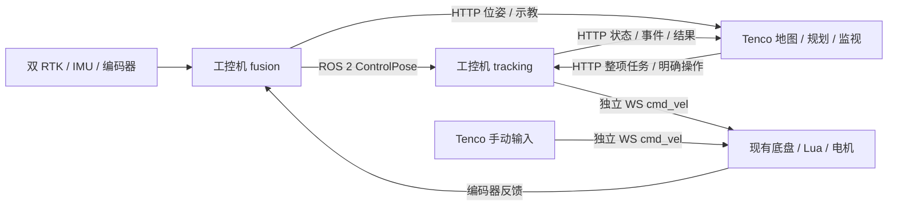

# 整个项目空间总览

更新日期：2026-10-14
会话 ID：`01a13477-9b6f-7f43-8a41-5e5b77886c15`
功能基线：src `55e9137`；Qt产品 `202eb10`；独立相机项目导入 `3291844`（Tenco历史功能 `af6e730` 的服务树，原生采集/压缩存档/Capture配置）。此次源码拆分的提交/快照见当前状态。在线相机Release SHA256 `f0450ba8177a760df0ec001e143925188443a3d190d9a75f2c8d3cd7bc862390`，2026-10-13 22:08已部署；历史依赖及此次迁移 PR 未合并，ROS/车辆控制未部署。

## 1. 项目目标与实际范围

面向温室场景的两轮差速巡检车，融合双 RTK、IMU 和轮编码器得到权威位姿；工控机自主完成路径跟踪与任务执行；Windows Qt 上位机负责地图、示教、规划、整项任务下发、反馈和独立手动控制。

项目空间同时包含三个独立仓库、底盘脚本、厂家驱动/SDK、部署工具和工程文档。软件链路已经实现并通过所列验证，实车部署、绝对精度和目标机长时间运行仍未完成，详情见[当前状态](当前状态.md)与[问题与待办](问题与待办.md)。

## 2. 全空间目录与职责

| 目录/文件 | 内容及状态 |
|---|---|
| `src/control_common/` | C++17 共享控制契约、标定/原点、ControlPose 构建、HTTP、存储、时间/队列基础 |
| `src/tracking_node/` | Pure Pursuit、路径几何、速度约束、完整任务执行器、HTTP 命令/结果/事件、独立底盘 WS |
| `src/sensor_fusion/` | UKF/EKF、RTK 串口/编码器解析、IMU 与可选视觉输入、ControlPose ROS/HTTP 出口、回放/参数工具 |
| `src/furrow_msgs/` | 视觉垄线测量消息 |
| `src/furrow_vision/` | 温室垄线检测与视觉约束相关工具；厂家驱动与视觉全链不在四包 CI 范围内 |
| `src/wit_ros_ws/` | WIT IMU ROS 2 驱动，包名 `wit_ros_imu`，RViz 预设 |
| `src/OrbbecSDK_ROS2-master/` | Orbbec ROS 2 驱动、消息/描述和厂家 SDK，保留原许可及所需库 |
| `src/sensor_fusion/third_party/websocketpp/` | 作为普通源码文件管理的网络依赖 |
| `src/standalone/` | Windows/Linux 无 ROS 控制核心、模拟服务及 CTest 构建入口 |
| `src/deployment/` | 环境盘点、成套构建清单、校验、systemd 包装、激活/回退及测试 |
| `Tenco/` | Qt 6 Widgets/C++20 上位机独立仓库，CMake/Ninja 构建 |
| `oak-camera-service/` | 工控机独立相机 HTTP 服务仓库；C++17/DepthAI/OpenCV/FFmpeg，源码、测试、脚本与 systemd 配置独立维护 |
| `Tenco/tests/` | 算法/协议/配置/地图/客户端测试、真实 Qt 联调和 GUI 冒烟 |
| `script/` | 现有底盘电机/CAN/PLC/云台相关 Lua 与配置；当前保持原样，53 文件历史完整性核对 |
| `docs/` | 工控机资料、历史审查/验证、新的项目实时记录及会话索引 |
| 根总体方案 | 当前 V3.1 的配套系统规格，历史 V2 在仓库文档中保留 |
| `bin/` / `tmp/` | 程序输出、临时证据及测试缓存，不是当前源码事实来源 |

`src/CMakeLists.txt` 仍是历史 catkin 文件，现有 ROS 包使用 ament；不要将目录名 catkin_ws 误解为现在应使用 catkin_make。

2026-10-14 / MOVE-20261014-01：相机源码由 Tenco 的历史 `services/oak-camera/` 抽取到并列独立 `oak-camera-service/`，Git历史保留，三个仓库分别维护版本与 PR。Tenco保留客户端；本地源码组织拆分没有同步、迁移或重启工控机现有服务，Capture绝对路径保持。下文恢复/清理/原生验收段落是当时事实，现源码归属以独立项目为准。见 [迁移记录](https://github.com/DAC-Code25/oak-camera-service/blob/chore/standalone-project-v1/docs/develop/%E7%9B%B8%E6%9C%BA%E6%9C%8D%E5%8A%A1%E7%8B%AC%E7%AB%8B%E9%A1%B9%E7%9B%AE%E8%BF%81%E7%A7%BB%E5%BC%80%E5%8F%91%E6%96%B9%E6%A1%88%E4%B8%8E%E8%AE%B0%E5%BD%95.md)。

## 3. 上位机模块

| 模块 | 当前功能与边界 |
|---|---|
| MainWindow / Home | 页面协调、状态展示、独立手动输入、视频及业务入口；不运行自动跟踪 |
| Map / MapDocument / MapGeometry | 点线弧编辑、地图文件、单垄/多垄模型、路径/航向图形和保存保护 |
| RoutePathFinder / MapRoutePlanner | 复用加权最短路/Dijkstra 规划及地图边适配，不引入 Nav2 |
| MapFrameAdapter | 地图和 ENU 控制坐标双向绑定；显示旋转与规划版本分离 |
| TaskCompiler | 将常规路线、单垄、多垄编译为整项 follow_path/turn/wait 与循环步骤 |
| PoseClient / TrackingClient / JsonHttpClient | 同源位姿获取、任务上传/回读、显式操作、请求结果和状态/事件；有并发/大小/超时限制 |
| ControlSessionCoordinator | 任务操作会话、计划/版本校核与接续；不仲裁手动/自动控制 |
| HomeManualInputState / MotionCommandArbiter / ChassisClient | 本地手动输入合成、按住重复、松键停止、原 WS 速度发送；无底盘许可握手 |
| ExternalEventCoordinator | 停车后相机业务、意图/结果持久化与事件确认；未知结果需人工核对 |
| StatusClient / HomeNetworkWorker / StatusProtocol | 底盘设备状态 HTTP 轮询、后台线程、退避、字段展示；控制位姿来自工控机 |
| VideoClient / VideoFrameWorker | MJPEG 拉流、工作线程解码、最新帧、限帧、截图/录像、重连与指标；另有 USB/OAK 支持 |
| ConfigManager / Maintenance | 配置载入/校验/迁移、维护与工控机标定只读显示 |
| LoggingManager / 本地存储 | 分类/审计/脱敏/轮转、诊断包与 SQLite；PostgreSQL/TimescaleDB 是扩展方向，不称已全面落地 |

内部构建库为 `tenco_config`、`tenco_logging`、`tenco_storage`、`tenco_motion`、`tenco_map_model`、`tenco_network`、`tenco_video`。UI 更新在主线程，设备/状态/视频/日志后台工作有各自生命周期。

远端相机服务与 `src` 中 Orbbec ROS 驱动是不同链路：现配置通过 HTTP 访问工控机 OAK/DepthAI 服务。原在线版本源码在目标机 `/home/nvidia/tenco-oak-probe`（非 Git 目录），新的受控版本源与隔离开发目录见下段；systemd 为 `tenco-oak-camera.service`，运行 `/opt/tenco/bin/oak_camera_service`，DepthAI 2.31.1。2026-10-13 续查确认原在线版本在 USB 运行连接掉线后出现 preview/X_LINK_ERROR，采集线程退出而 HTTP 主进程仍运行，无重建/故障缓存清除，systemd on-failure 不触发，流发旧帧后等 2 秒结束。掉线诱因与新版本真实设备恢复尚未验证，见 [P-009](问题与待办.md) 和 [排查记录](https://github.com/DAC-Code25/Tenco/blob/refactor/oak-camera-standalone-v1/docs/develop/%E7%9B%B8%E6%9C%BA%E6%96%AD%E6%B5%81%E6%8E%92%E6%9F%A5%E5%BC%80%E5%8F%91%E8%AE%B0%E5%BD%95.md)。服务可达不等于相机采集健康。

FIX-20261013-01 已将必要服务源码纳入 Tenco `services/oak-camera/`，C++17独立构建，不加入Windows Qt链接，原远端非Git目录保留。新增采集失败/卡帧退避重建、单调新鲜度/503拒旧帧、错误与状态诊断、录像停止和HTTP资源回收；隔离副本 `/home/nvidia/tenco-oak-probe-recovery-v1` 已通过Jetson构建/模拟回归及真实Qt客户端联调。20:04旧版本再次采集失败，用户授权后20:06已备份/切换新版，PID16018/运行哈希与已验证Release一致；真实流45秒677帧约15FPS，Qt299帧零错误。真实USB故障恢复/硬件诱因、失败回退和长期验收仍保留，旧unit宽泛pkill登记P-010；详见 [服务说明](https://github.com/DAC-Code25/oak-camera-service/blob/chore/standalone-project-v1/README.md) 和 [开发记录](https://github.com/DAC-Code25/Tenco/blob/refactor/oak-camera-standalone-v1/docs/develop/OAK%E7%9B%B8%E6%9C%BA%E9%87%87%E9%9B%86%E6%81%A2%E5%A4%8D%E5%BC%80%E5%8F%91%E8%AE%B0%E5%BD%95.md)。

CLEAN-20261013-01：用户随后要求始终只留最新版，已删除上段历史旧工程与旧程序备份、闲置probe程序/disabled服务、Debug构建与假源临时产物，保留最新目录/Release/受控历史/业务媒体/运行依赖。有效厂家PDF迁至新版docs/hardware并核对哈希；当前回退方法不能使用已删除备份。部署事务临时旧程序在成功持续新帧/哈希确认后删除，失败先恢复，未来不积累长期历史副本；实际清单与验证见 [清理记录](https://github.com/DAC-Code25/Tenco/blob/refactor/oak-camera-standalone-v1/docs/develop/%E7%9B%B8%E6%9C%BA%E6%97%A7%E7%89%88%E6%9C%AC%E4%B8%8E%E5%A4%87%E4%BB%BD%E6%B8%85%E7%90%86%E5%BC%80%E5%8F%91%E8%AE%B0%E5%BD%95.md)。本地旧诊断副本删除受策略阻止(D-006)，工控机清理全部完成且当前服务未重启。

CAPTURE-20261013-01 当前相机链路：IMX378原生4056×3040 ISP YUV420经USB3，预览960×540独立；上位机远端拍照JPEG90、录像H.264/yuv420p分片MP4，完整原生尺寸。原生存档在 `/home/nvidia/tenco-oak-probe-recovery-v1/Capture`，旧业务媒体不迁移/删除；原生/预览5秒无帧都重建、1秒旧原生帧拒拍照/新录像，故障封装并停止录像。共享原生缓冲/有界3帧编码队列、真实时间戳/丢帧与写错误统计，保存完成与录像活动分开。Orin Nano软件H.264原生录像实测约4.5～5.1FPS、33.5～38.6Mbps，保持原生尺寸但尚未达15FPS；实际容量/负载依场景，P-011继续优化，Ubuntu现有GStreamer与ffmpeg完整解码已验证。systemd受控drop-in覆盖绝对路径并清空旧宽泛pkill，仅管理本服务cgroup；开机enabled、异常重启策略仍由原unit负责。详见 [原生采集记录](https://github.com/DAC-Code25/Tenco/blob/refactor/oak-camera-standalone-v1/docs/develop/OAK%E5%8E%9F%E7%94%9F%E6%8B%8D%E7%85%A7%E5%BD%95%E5%83%8F%E5%BC%80%E5%8F%91%E8%AE%B0%E5%BD%95.md)。

## 4. 数据与通信

| 接口 | 默认或示例 | 语义 |
|---|---|---|
| ROS 控制位姿 | `/sensor_fusion/control_pose` | 同机控制快照，含状态与观测年龄、编码器实测速率和坐标版本 |
| 融合 HTTP | `18131/api/v1` | 位姿/健康/配置和静止示教 |
| tracking HTTP | `18130/api/v1` | 整项任务、操作会话、命令查询、执行历史、事件/确认、原点管理 |
| 底盘速度/反馈 WS | `192.168.31.7:1202` 示例 | 既有 cmd_vel、ScriptDeal 编码器反馈；各用途独立连接 |
| 底盘状态 HTTP | `192.168.31.7:9999/table/reads` 示例 | 电池/模式等状态，不承担控制位姿转发 |
| 相机服务 | `192.168.31.13:18080` 示例 | 上位机视频/拍摄业务 |
| 云台 PLC | `192.168.31.120:502` 示例 | Modbus TCP 云台/升降等已有业务 |

IP、端口和监听范围来自配置，现场必须核对。正式对外 HTTP 设置 Bearer 认证；commissioning 默认回环监听。协议传 `xvel` m/s、`thetavel` rad/s、`yvel=0`、`isRemote=true`；本地 connectionId 只隔离旧连接，不能冒充底盘 bootId 或硬件命令 TTL。

## 5. 自动任务与手动工作流程

手动：输入 → 本地合成 → ChassisClient → 原 WS。按住重复发送，松键本通道零速，断线清空输入，重连不重放；不经过 tracking，不申请许可。

自动：读取并绑定当前原点/标定 → 地图/示教规划 → 编译完整点列和步骤 → 上传与持久化 → Ready → 用户明确 start → 校核坐标版本、定位、连接与实测停稳 → tracking 20 Hz 自主执行 → 状态/事件/完成结果回读。

follow_path 通过路径投影、前视点及车体系曲率计算角速度；速度规划同时约束曲率、左右轮速度、加减速及停车距离。接近端点先减速再检查实际停稳，明确处理对准、制动、掉头、等待与循环；返程可转向后前进。当前默认停稳阈值为线速 0.02 m/s、角速 0.03 rad/s、持续 150 ms，现场效果待验证。

上传不自动启动，确认计划不自动恢复。重开接续读取服务实际计划，核验任务/执行/坐标身份、预览并确认，再显式 resume。写请求有唯一 ID 和结果查询，响应丢失不重新盲发启动。planHash 是服务身份值，Qt 不自行重算其 JSON 数字序列化结果。

Tenco 退出或操作会话过期不暂停已启动的普通自动任务。拍照 external_ack 到点后仍等待上位机完成业务确认；底盘/定位/编码器失联、发送/控制超期和进程重启按自身通道保护，重启仅恢复历史供查询，不恢复运动。

## 6. 坐标、配置与持久化

控制坐标为 ENU/map，米与弧度；车体系 base_link 位于驱动轮轴中心。统一轮距 0.25 m、轮径 0.20 m、65536 轮端 ticks。Qt Y 轴向下的角度符号在显示层转换，参考点外参仅应用一次。地图点、实时车标、规划下发共用绑定版本。

`control_common/config/<profile>` 是共享车辆标定、原点、定位策略、场地和 tracking 配置来源。commissioning 除已统一几何外仍需现场标定，simulation 只用于回环。fusion 后备 YAML 可继承，但合法共享几何覆盖它。原点磁盘 pending 与运行 active 分离，运行反馈与停稳确认后生效。

执行状态、事件/确认和请求去重持久化。写入在发布成功结果前完成；SHA256 有界账本兼容旧历史迁移；完成历史不被后续急停改写。每 60 秒执行七天历史/关联事件清理，保护当前执行；大任务解析/写盘不阻塞小包心跳入口。完整任务文档最大 16 MiB，Qt 仅任务回读允许该上限。

## 7. 部署、验证和历史适用性

无 ROS 控制核心与真实服务可在 Windows 构建；Qt 使用固定 6.5.3/MinGW 11.2 Kit。生产节点 CI 使用 Ubuntu 22.04 / ROS 2 Humble / x86_64，四包为 control_common、furrow_msgs、sensor_fusion、tracking_node。厂家驱动、目标 Jetson ARM64、真实设备和全部视觉链必须另外验证。

部署工具提供主机盘点、四包构建测试、清单/哈希/架构/配对 SHA 校验、迁移安装目录、install-only、systemd 激活和成套回退；实现了工具不等于在实机执行过完整生命周期。Windows 程序/x86 包不能直接复制至 ARM64 运行。

历史证据见 [完整修复与验证](位姿地图全链路修复与验证-2026-09-19.md)、[审查报告](系统架构与测试覆盖审查-2026-09-19.md)、两仓 `docs/develop/`。本次文档治理沿用源码基线，不重跑无关产品套件。

旧文档如 sensor_fusion README 的 Noetic/catkin 说明、旧总体 V2 和早期互锁描述按历史阅读。当前入口是根 AGENTS、此总览、当前状态和 V3.1 总体方案；发现相反说明时登记并修订当前文档，历史报告保留原事实。
